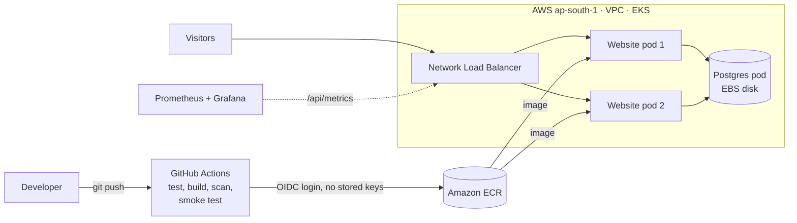

# Devagent

[](https://github.com/prapanjanprabhu/Devagent/actions/workflows/ci.yml)
[](https://github.com/prapanjanprabhu/Devagent/actions/workflows/terraform.yml)
[](https://github.com/prapanjanprabhu/Devagent/actions/workflows/k8s.yml)


An AI front desk for appointment businesses (salons, clinics, studios, tutors). Customers book, order and ask questions on WhatsApp or the web, and the assistant fills the calendar, takes deposits and sends reminders.

The app is deployed to **AWS EKS** with **Terraform**, and every `git push` to `main` is tested, built, scanned and rolled out to the cluster with no downtime.

## Architecture



- **Terraform** builds the VPC, the EKS cluster (2 nodes), the ECR registry and the IAM role GitHub uses to deploy.
- **Kubernetes** runs **1 database pod** (Postgres with its own disk) and **2 website pods**. The website pods keep no data, so any pod can serve any visitor.
- **GitHub Actions** logs in to AWS with OIDC, so no AWS keys are stored in GitHub.

## Tech stack

| Area | Tools |
|---|---|
| App | Next.js 15, React 19, TypeScript, Postgres 16 |
| Containers | Docker (multi-stage, non-root, health check) |
| Infrastructure as code | Terraform (AWS provider, community VPC and EKS modules) |
| Orchestration | Kubernetes 1.35 on AWS EKS, Kustomize |
| CI/CD | GitHub Actions, Amazon ECR, GitHub Container Registry |
| Security | GitHub OIDC to AWS, Trivy image scan, non-root containers, Kubernetes secrets |
| Monitoring | Prometheus metrics endpoint, Grafana dashboard, `/status` page, JSON logs |
| Tests | Vitest, 25 tests against a real Postgres |

## Features

- AI front desk on WhatsApp and the web that books, takes orders and captures enquiries, using only the business's real services, prices and hours. Without an AI key it falls back to a rule-based assistant.
- Calendar with availability, staff capacity, blocked time, walk-ins and no-show tracking.
- Deposits that hold a slot and release it automatically if unpaid, plus prepaid session packs.
- 24-hour and 2-hour reminders, and a waitlist that is offered freed slots.
- Orders, an enquiry pipeline, multi-seat classes, campaigns, a "grow" agent and analytics.
- Multi-tenant: each business's data is kept separate.

## Repository layout

| Path | What it holds |
|---|---|
| `src/` | The Next.js app (pages, API routes, data layer in `src/lib`) |
| `tests/` | Unit and concurrency tests |
| `infra/terraform/` | VPC, EKS, ECR and GitHub OIDC role. Guide: [infra/README.md](infra/README.md) |
| `k8s/` | Kubernetes manifests: database, website, load balancer. Guide: [k8s/README.md](k8s/README.md) |
| `.github/workflows/` | CI, deploy, Terraform check, Kubernetes check, release |
| `monitoring/` | Prometheus config and the Grafana dashboard |
| `docs/` | [DevOps guide](docs/DEVOPS.md) and the [product analysis](docs/ANALYSIS.md) |

## Run it locally

### With Docker (recommended)

```bash
cp .env.example .env
docker compose up -d --build                        # Postgres + app on http://localhost:3100
docker compose --profile monitoring up -d --build   # adds Prometheus :9090 and Grafana :3001
```

### Without Docker for the app

```bash
npm install
docker compose up -d db          # Postgres on localhost:5440
cp .env.example .env.local       # then edit
npm run dev -- -p 3100
npm test                         # needs the Postgres above
npm run typecheck
```

Needs Node 20.9 or newer. Then sign up at `/signup`, describe your business at `/onboarding`, and share `/book/<id>` or the chat widget snippet from the dashboard.

## Deploy to AWS

1. Create the infrastructure (about 15 minutes):
   ```bash
   cd infra/terraform
   terraform init
   terraform apply
   ```
2. In GitHub, add the repository variables `AWS_REGION`, `AWS_ROLE_ARN`, `EKS_CLUSTER` and `ECR_REPOSITORY` (values come from `terraform output`), and the secret `POSTGRES_PASSWORD`.
3. Push to `main`. The deploy job prints the website address in its summary.

Step-by-step details, cost and clean-up are in [infra/README.md](infra/README.md) and [k8s/README.md](k8s/README.md).

## CI/CD pipeline

| Workflow | Runs on | What it does |
|---|---|---|
| `ci.yml`: test | Every push and pull request | Typecheck, 25 tests against a Postgres service, production build |
| `ci.yml`: docker | After test | Builds the image, starts 1 database and 2 app containers, calls the health endpoints on both, scans the image with Trivy |
| `ci.yml`: publish | Push to `main` and `v*` tags | Pushes the image to GitHub Container Registry |
| `ci.yml`: deploy | Push to `main`, once AWS is set up | Pushes the image to ECR, applies `k8s/`, waits for the rollout, checks the live site runs the new commit |
| `terraform.yml` | Changes in `infra/terraform` | `terraform fmt` and `validate` |
| `k8s.yml` | Changes in `k8s/` | Renders the manifests and checks them against the Kubernetes schemas |
| `release.yml` | `v*` tags | Creates a GitHub release |

## Health and monitoring

| URL | Purpose |
|---|---|
| `/api/health` | Liveness (used by Docker and the Kubernetes liveness probe) |
| `/api/ready` | Readiness: returns `503` when the database is unreachable, so traffic stops going to that pod |
| `/api/version` | Version, commit, build time and uptime |
| `/api/metrics` | Prometheus metrics. Set `METRICS_TOKEN` to require a bearer token |
| `/status` | Live status page |

## Running two website pods safely

Moving from one copy of the app to two needed real changes, all covered by tests:

- **No double bookings.** A database lock per business means two pods cannot sell the same slot at the same moment.
- **No duplicate reminders.** Only one pod at a time runs the background reminder job.
- **No oversold stock.** Stock is reduced in a single atomic update.
- **Messages only after saving.** WhatsApp messages are sent only once the booking is committed.

## Configuration

The app works without these, in a logged-only mode.

| Feature | Needs |
|---|---|
| AI replies and AI onboarding | `ANTHROPIC_API_KEY` |
| Real WhatsApp messages | Meta WhatsApp Cloud API credentials per business (in **Connect**), webhook `/api/whatsapp`, and `WA_APP_SECRET` in production |
| Online deposits | Razorpay key and secret per business (not yet tested against Razorpay) |
| Call Rescue | A telephony provider calling `/api/calls/missed` with `x-rescue-secret` |
| Plan switching | Demo only, with `DEV_BILLING=1` |

## Known limits

- One database pod is a single point of failure. For production, use a managed database such as AWS RDS.
- The cluster serves plain HTTP. HTTPS needs a domain, a certificate and an ingress controller.
- To keep the demo cheap, the worker nodes sit in public subnets with no NAT gateway.
- Not built yet: Google Calendar sync, subscription payments, social login and WhatsApp template management.
