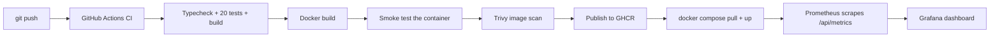

# DevOps guide

How Devagent is built, tested, shipped and watched. Everything here runs on one laptop with Docker.

## The pipeline



| Stage | File | What it does |
|---|---|---|
| CI | `.github/workflows/ci.yml` | Typecheck, unit tests, production build, then builds the image and calls the health endpoints inside the running container |
| Publish | `.github/workflows/ci.yml` (job `publish`) | On `main` and `v*` tags, pushes `ghcr.io/prapanjanprabhu/devagent` with tags `latest`, the short commit and the version |
| Release | `.github/workflows/release.yml` | A `v*` tag creates a GitHub release with auto-generated notes |
| Updates | `.github/dependabot.yml` | Weekly PRs for npm packages, the Docker base image and the Actions |

## Run it with Docker

```bash
cp .env.example .env
docker compose up -d --build              # app on http://localhost:3100
docker compose --profile monitoring up -d --build   # + Prometheus :9090 and Grafana :3001
```

Build info is baked into the image, so the running version is always visible:

```bash
GIT_SHA=$(git rev-parse --short HEAD) BUILD_TIME=$(date -u +%FT%TZ) docker compose up -d --build
curl localhost:3100/api/version
```

The SQLite database lives in the `devagent-data` volume, so rebuilding or upgrading the container keeps the data.

## Health, status and metrics

| URL | Purpose |
|---|---|
| `/api/health` | Liveness. Used by the Docker `HEALTHCHECK` |
| `/api/ready` | Readiness. Returns `503` if the database is not usable |
| `/api/version` | Version, commit, build time, Node version, uptime |
| `/api/metrics` | Prometheus metrics (set `METRICS_TOKEN` to require a bearer token) |
| `/status` | Live status page (auto-refreshes every 5 seconds) |

Logs are one JSON object per line (`docker logs devagent`). Set `LOG_LEVEL=debug` for more.
On `docker stop` the app receives SIGTERM, logs `shutting down`, and exits cleanly.

## Try it yourself (good for a demo video)

1. `docker compose --profile monitoring up -d --build`
2. Open the app, sign up, finish onboarding, make a booking from the public page
3. Open `/status` and watch uptime tick; open Grafana (`localhost:3001`) and watch bookings appear
4. `docker kill devagent` and watch the status panel go red, then `docker compose up -d` brings it back and the booking is still there (data volume)
5. Push a commit and watch the Actions run go through test, build, smoke test and publish

## Branch and commit style

Small commits, plain English, one change each. `main` is always deployable.

## What is not included (on purpose)

- **No automatic deploy to a server.** CI publishes the image; to deploy, run `docker compose pull && docker compose up -d` on any machine with Docker. Adding an SSH or cloud deploy step needs your own server and secrets.
- **No Kubernetes or Terraform.** One container plus a volume is enough for a single SQLite-backed instance. SQLite also means one running replica, not many.
- **Prometheus metrics are business and process gauges, not per-request latency.**
