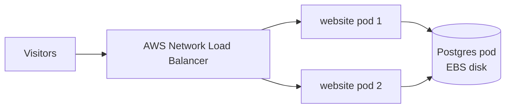

# Kubernetes (runs on the EKS cluster from `infra/terraform`)



| File | What it creates |
|---|---|
| `namespace.yaml` | The `devagent` namespace |
| `storageclass.yaml` | `gp3` EBS disks for the database |
| `postgres.yaml` | **1** Postgres pod (StatefulSet) with a 5 GB disk, reachable inside the cluster as `postgres:5432` |
| `app.yaml` | **2** website pods (Deployment), the public load balancer (Service) and a PodDisruptionBudget |
| `kustomization.yaml` | Ties the files together: `kubectl apply -k k8s` |

## Why this design works

- The website pods keep **no data**. Sessions, bookings and everything else live in Postgres, so any pod can serve any visitor and there is no need for sticky sessions.
- Two pods booking at the same moment cannot sell the same slot (a database lock per business), and only one pod runs the 60-second reminder job (a database lock), so customers never get duplicate messages.
- Updates are rolling: a new pod starts and passes its health check before an old one stops (`maxUnavailable: 0`), so the site stays up while a new version goes out.
- Readiness checks the database, liveness does not. If the database is down, the pods stop receiving traffic but are not restarted in a loop.

## What the deploy workflow does (`.github/workflows/ci.yml`, job `deploy`)

On every push to `main`, after tests and the Docker smoke test pass:

1. Builds the image and pushes it to your ECR repository (tagged with the commit and `latest`).
2. Creates the `devagent-secrets` Secret from your GitHub secrets, and the `devagent-config` ConfigMap (`BASE_URL`).
3. Applies `k8s/` with the new image, waits for the load balancer address, and waits for the database and both pods.
4. Calls `/api/ready` and `/api/version` on the live address and checks that it runs the commit that was just pushed. The address is printed in the job summary.

Until you set the `AWS_ROLE_ARN` repo variable, this job is skipped and CI stays green.

## First-time setup

1. Create the AWS side: [infra/README.md](../infra/README.md) (VPC, EKS, ECR, GitHub login).
2. In GitHub (Settings > Secrets and variables > Actions) add the variables listed in the infra guide, and the secret:

| Secret | Needed? | Notes |
|---|---|---|
| `POSTGRES_PASSWORD` | **Yes** | 16 or more letters and numbers, no symbols. The first deploy sets it as the database password. Changing it later does **not** change the existing database. |
| `ANTHROPIC_API_KEY` | No | Real AI replies. Without it the rule-based assistant is used. |
| `WA_APP_SECRET` | No | Meta app secret to verify WhatsApp webhooks |
| `RESCUE_WEBHOOK_SECRET` | No | Shared secret for the Call Rescue webhook |
| `METRICS_TOKEN` | No | Protects `/api/metrics` |

3. Push to `main`. The site address appears in the deploy job summary.

## Useful commands

```bash
kubectl -n devagent get pods -o wide           # both website pods and the database pod
kubectl -n devagent get svc devagent           # EXTERNAL-IP is the website address
kubectl -n devagent logs deploy/devagent --tail=50
kubectl -n devagent scale deploy/devagent --replicas=3
kubectl -n devagent rollout undo deploy/devagent   # go back to the previous version
kubectl -n devagent exec -it postgres-0 -- psql -U devagent devagent
```

## Limits (be honest in the demo)

- **One database pod** is a single point of failure. If its node dies, the website shows "not ready" until it comes back (the disk is kept). For real production use AWS RDS with a standby.
- **HTTP only.** For HTTPS add an AWS Load Balancer Controller or ingress, an ACM certificate and a domain.
- The rate limiter on the public booking and chat endpoints counts per pod, so the real limit is about double with two pods.
- The load balancer annotations and the EBS disk driver follow AWS documentation but were written without access to a real AWS account, so expect to adjust small things on the first deploy.
